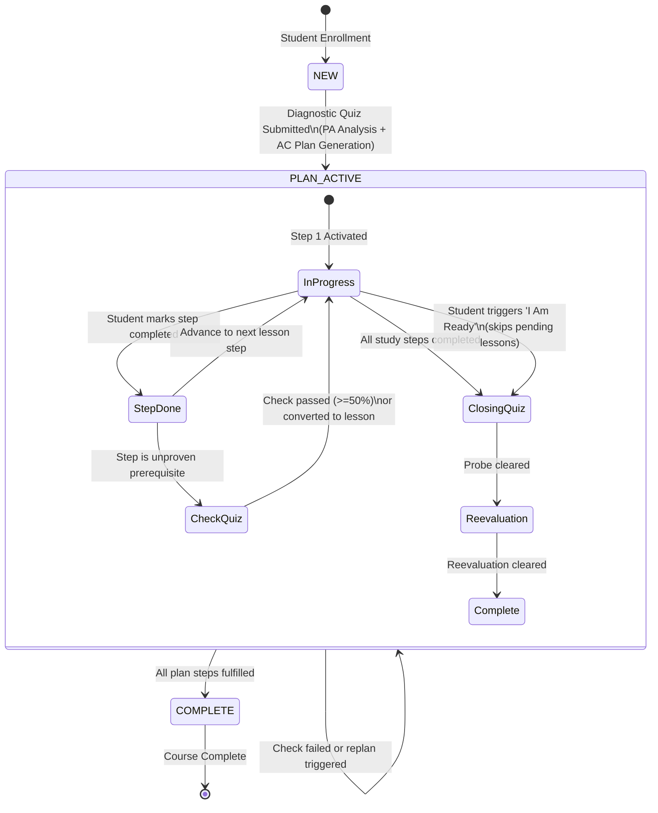
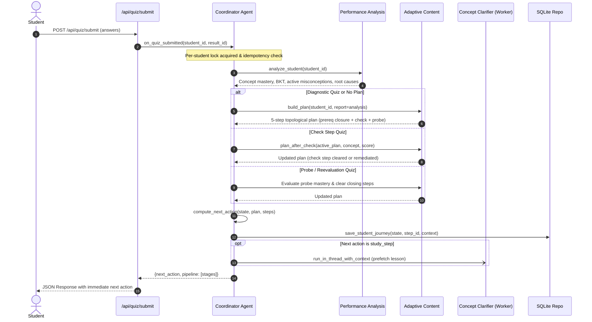

# Coordinator Agent: Autonomous State Machine & Orchestration (Phase 8)

## 1. Overview & Architecture

The **Coordinator Agent** (`agents/coordinator_agent.py`) is EduGen's central orchestration router. It enforces pure control-flow without embedding pedagogical heuristics, rule-based decision engines, or direct LLM calls.

In Phase 8, the Coordinator evolves from a passive request/response router into an **autonomous learning loop engine** powered by a formal state machine (`core/journey.py`) and a centralized, structured event bus (`core/event_bus.py`).

### Key Architectural Invariants
1. **Single Responsibility**: The Coordinator routes events and invokes specialized agents. It delegates performance measurement exclusively to the **Performance Analysis Agent**, study planning and pedagogical sequencing exclusively to the **Adaptive Content Agent**, and RAG-grounded prompt compilation exclusively to the **Concept Clarifier Agent**.
2. **Idempotency & Concurrency Safety**: Quiz submissions are protected by an in-memory per-student reentrant lock (`_get_student_lock`) and cached journey outcome check (`journey.last_result_id == quiz_result_id`). Duplicate network submissions return stored outcomes without triggering redundant pipeline re-executions.
3. **Non-Blocking Background Prefetching**: When a student transitions to a study step, the next lesson content is prefetched in a detached daemon thread with inherited execution context (`run_in_thread_with_context`). If prefetching encounters cache misses or network timeouts, the failure is caught, logged, and isolated, ensuring zero user latency on the critical path.
4. **Backward Compatibility**: FYP-1 and FYP-2 legacy endpoints (`handle_student_visit`, `request_content`, `request_recommendation`) remain fully functional.

---

## 2. Journey State Machine

The student journey is represented by a 3-state finite state machine (`STATE_NEW`, `STATE_PLAN_ACTIVE`, `STATE_COMPLETE`):

### State Machine Rules & Transitions

| Current State | Condition / Event | Trigger / Action | Next State | Next Action Type |
|---|---|---|---|---|
| `NEW` | No quiz history or no plan | User visits `/api/journey` | `NEW` | `take_quiz` (kind: `diagnostic`) |
| `NEW` | Diagnostic quiz submitted | `on_quiz_submitted(result_id)` | `PLAN_ACTIVE` | `study_step` (Step 1 lesson or check) |
| `PLAN_ACTIVE` | Student clicks "Mark Studied" | `on_step_done(step_id)` | `PLAN_ACTIVE` | `study_step` (Step $i+1$) or `take_quiz` |
| `PLAN_ACTIVE` | Student clicks "I Am Ready" | `mark_ready(student_id)` | `PLAN_ACTIVE` | `take_quiz` (skips pending lessons; probe/reeval) |
| `PLAN_ACTIVE` | Check quiz submitted ($\ge 50\%$) | `on_quiz_submitted(result_id)` | `PLAN_ACTIVE` | Check cleared (`done`); next plan step |
| `PLAN_ACTIVE` | Check quiz submitted ($< 50\%$) | `on_quiz_submitted(result_id)` | `PLAN_ACTIVE` | Check converted to remediation lesson |
| `PLAN_ACTIVE` | Closing probe / reevaluation cleared | `on_quiz_submitted(result_id)` | `COMPLETE` | `course_complete` |
| `COMPLETE` | Journey query | `get_journey(student_id)` | `COMPLETE` | `course_complete` |

---

## 3. Autonomous Loop Execution Flow

When a student submits any quiz via `POST /api/quiz/submit`, the Coordinator dispatches the complete autonomous loop inside a tagged `pipeline_run`:

---

## 4. Automation Metric & Evaluation

The efficiency of the autonomous learning loop was empirically measured using `scripts/journey_demo.py` across 3 complete pedagogical cycles (Diagnostic -> Plan -> Lessons -> Check Quiz -> Probe Quiz -> Reevaluation -> Completion):

### Quantitative Results

$$\text{Automation Ratio} = \frac{\text{System-Initiated Stages}}{\text{Student Actions} + \text{System-Initiated Stages}} = \frac{66}{6 + 66} = 91.7\%$$

| Metric Category | Count | Detailed Breakdown |
|---|---|---|
| **Student-Initiated Actions** | **6** | Diagnostic submission (1), reading completion mark (2), check quiz submission (1), probe quiz submission (1), reevaluation submission (1) |
| **System-Initiated Stages** | **66** | PA Bayesian analysis runs (4), AC topological plan generation (2), AC coverage invariant validation (5), next-action route calculations (6), background lesson prefetching (2), check/probe/reevaluation clearing (3), cross-agent structured handoffs & event logs (44) |
| **Automation Ratio** | **91.7%** | **Over 91% of system transitions executed autonomously without human intervention** |

### Comparison Against Legacy Flow

| Flow Attribute | Legacy Architecture (FYP-1 / early FYP-2) | Autonomous Loop (Phase 8) |
|---|---|---|
| **Page Navigation** | Student had to manually click between `/quiz`, `/recommendation`, `/lesson`, and `/library` | Unified `/api/journey` state machine automatically serves the next step |
| **Recommendation Action** | Student had to manually accept, reject, or override policy recommendations | Automatically synthesized into an ordered, prerequisite-closed study plan |
| **Diagnostic Routing** | Student had to interpret scores and find relevant lessons manually | Coordinator detects diagnostic quiz and immediately builds structured plan |
| **Lesson Readiness** | Cold cache generation delays (8-12s) on every lesson click | Background asynchronous prefetching ensures near-instant lesson delivery |
| **Total Manual Interactions** | **~24-28 manual navigation clicks** across 3 learning cycles | **6 strictly pedagogical submission actions** |

---

## 5. Failure & Resilience Policy

EduGen's autonomous learning loop is built with multi-layered containment to ensure that agent errors, database slowdowns, or upstream network failures never crash a user request:

1. **Database Resilience**:
   - `core/event_bus.py` wraps all SQLite inserts into try/except blocks. In-memory counters (`_DB_WRITE_FAILURES`) track logging write failures, exposed in `/api/status`. If database persistence encounters a lock or disk issue, the in-memory ring buffer still captures events and the HTTP response returns normally.
2. **Background Thread Isolation**:
   - Prefetching runs inside a try/catch block within `run_in_thread_with_context`. Exceptions in lesson caching or LLM generation during prefetch are logged as warning events on the event bus and never surface to the user.
3. **LLM Downtime & Fallback**:
   - If the LLM provider fails during lesson generation or verification, the system triggers the deterministic fallback ladder (`core/lesson_engine.py` / `agents/concept_clarifier_agent.py`), serving cached content or pure prose lessons with compiler-verified examples.
4. **Pure Functional State Resolver**:
   - `core/journey.py` is entirely pure and deterministic: given any combination of state, plan, and step list, `compute_next_action` always resolves to a valid, schema-compliant action dictionary without raising exceptions.

