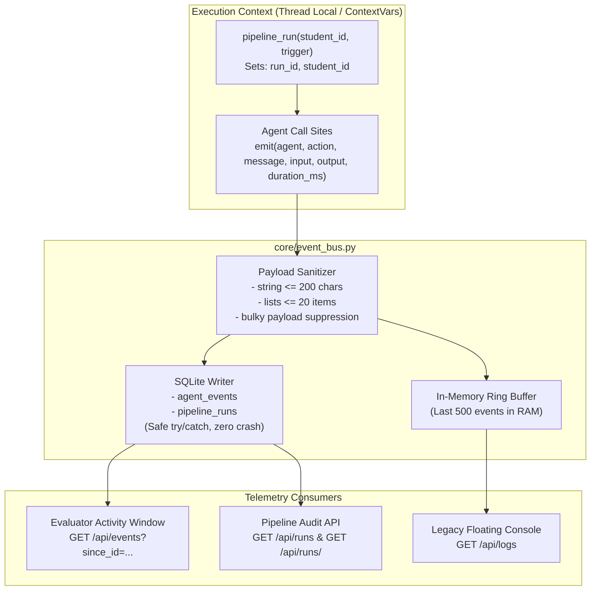

# Central Event Bus & Pipeline Telemetry (Phase 8)

## 1. Overview & Architecture

The **Central Event Bus** (`core/event_bus.py`) provides unified structured observability, inter-agent traceability, and high-performance telemetry across all four EduGen agents.

It replaces the unstructured textual log system (`core/agent_log.py`) with a schema-validated, asynchronous, multi-tiered telemetry pipeline:



### Key Architectural Invariants
1. **ContextVars Tagging**: `pipeline_run` sets `_current_run_id` and `_current_student_id` in Python `contextvars.ContextVar`. Every agent invocation automatically inherits and records the active run ID and student ID without requiring changes to function signatures.
2. **Safe Background Thread Propagation**: Asynchronous threads (such as prefetch workers) are spawned using `run_in_thread_with_context(func, *args, **kwargs)`, which snapshots the calling thread's `contextvars.copy_context()` and executes the thread within that exact context.
3. **Fail-Safe In-Memory Ring Buffer**: An in-memory `collections.deque(maxlen=500)` stores the latest events. Even if the SQLite database is temporarily busy or undergoing lock contention, events are never lost in memory, and the floating console (`/api/logs`) maintains real-time updates.
4. **Resilient Database Persistence**: Database write failures are caught, counted in `_DB_WRITE_FAILURES`, and exposed via `GET /api/status`. Telemetry logging errors are strictly prohibited from propagating or breaking HTTP responses.

---

## 2. Event Vocabulary & JSON Schemas

Every structured event emitted across the multi-agent system conforms to a standardized schema:

```json
{
  "id": 1042,
  "run_id": "run_20261103_091530_10",
  "student_id": 10,
  "agent": "Coordinator",
  "action": "run_start",
  "level": "info",
  "message": "Pipeline run started for student 10 (trigger: quiz_submit)",
  "input": {"trigger": "quiz_submit", "student_id": 10},
  "output": null,
  "duration_ms": null,
  "created_at": "2026-11-03 09:15:30"
}
```

### Full Event Catalog

#### 1. Lifecycle & Pipeline Orchestration
* **`run_start`** (Coordinator): Emitted at the start of an autonomous learning cycle.
  ```json
  {"agent": "Coordinator", "action": "run_start", "message": "Pipeline run started for student 10 (trigger: quiz_submit)", "input": {"trigger": "quiz_submit"}}
  ```
* **`run_end`** (Coordinator): Emitted when the pipeline run concludes.
  ```json
  {"agent": "Coordinator", "action": "run_end", "message": "Pipeline run finished with status 'success' (2 stages)", "duration_ms": 142}
  ```
* **`handoff`** (Coordinator / Agent): Explicit inter-agent delegation and data transfer.
  ```json
  {
    "agent": "Coordinator",
    "action": "handoff",
    "message": "-> Performance Analysis: analyzing student mastery after quiz submit",
    "input": {"from_agent": "Coordinator", "to_agent": "Performance Analysis", "context": {"quiz_result_id": 501}}
  }
  ```

#### 2. Performance Analysis Agent
* **`analyze`**: Emitted when BKT mastery computation and concept classification finish.
  ```json
  {
    "agent": "Performance Analysis",
    "action": "analyze",
    "message": "Analysis complete: 1 weak, 2 strong, 44 concepts tracked",
    "output": {"weak_count": 1, "strong_count": 2, "overall_performance": 78.5},
    "duration_ms": 32
  }
  ```
* **`misconception_active`**: Emitted when repeated distractor selection flags an active misconception.
  ```json
  {
    "agent": "Performance Analysis",
    "action": "misconception_active",
    "message": "Active misconception detected: method-overriding/return-type-overload",
    "output": {"misconception_id": "method-overriding/return-type-overload", "occurrences": 3}
  }
  ```
* **`misconception_resolved`**: Emitted when correct probe responses clear a previously active misconception.
  ```json
  {
    "agent": "Performance Analysis",
    "action": "misconception_resolved",
    "message": "Misconception cleared after probe: inheritance-basics/super-call-syntax",
    "output": {"misconception_id": "inheritance-basics/super-call-syntax"}
  }
  ```
* **`skill_gap`**: Emitted when code tracing or bug finding accuracy diverges significantly from theory.
  ```json
  {
    "agent": "Performance Analysis",
    "action": "skill_gap",
    "message": "Skill gap identified in module 'Polymorphism': Knows theory but struggles with code tracing",
    "output": {"module": "Polymorphism", "gap": "code_output", "divergence": 35.0}
  }
  ```

#### 3. Adaptive Content Agent
* **`plan_built`**: Emitted when topological sort and prerequisite closure assemble an ordered plan.
  ```json
  {
    "agent": "Adaptive Content",
    "action": "plan_built",
    "message": "Plan built with 5 steps, 0 deferred",
    "output": {"steps": 5, "deferred": 0, "coverage_ok": true},
    "duration_ms": 48
  }
  ```
* **`coverage_check`**: Emitted when formal invariant verification checks the plan.
  ```json
  {
    "agent": "Adaptive Content",
    "action": "coverage_check",
    "message": "Coverage check: PASSED (5/5 checks passed)",
    "output": {"ok": true, "violations": []}
  }
  ```

#### 4. Concept Clarifier Agent
* **`cache_hit`**: Lesson returned instantly from SHA-1 indexed disk cache.
  ```json
  {
    "agent": "Concept Clarifier",
    "action": "cache_hit",
    "message": "Lesson cache hit for concept 'method-overriding' (style: detailed)",
    "output": {"cache_key": "a4f89b...", "concept": "method-overriding"}
  }
  ```
* **`cache_miss`**: Lesson not found in cache; requires RAG retrieval and generation.
  ```json
  {
    "agent": "Concept Clarifier",
    "action": "cache_miss",
    "message": "Lesson cache miss for concept 'inheritance-basics' (style: simplified)"
  }
  ```
* **`retrieve`**: Passages retrieved against retrieval brief via hybrid vector + BM25 ranking.
  ```json
  {
    "agent": "Concept Clarifier",
    "action": "retrieve",
    "message": "Retrieved 4 passages for 'inheritance-basics' (top cosine score 0.842)",
    "output": {"chunks_count": 4, "top_score": 0.842},
    "duration_ms": 86
  }
  ```
* **`generate`**: LLM completion received and JSON-validated.
  ```json
  {
    "agent": "Concept Clarifier",
    "action": "generate",
    "message": "Lesson generated: 580 words across 4 sections",
    "duration_ms": 1420
  }
  ```
* **`java_check`**: Java code snippet evaluated through compiler gate.
  ```json
  {
    "agent": "Concept Clarifier",
    "action": "java_check",
    "message": "JDK compilation gate passed: 2 code blocks compiled cleanly",
    "output": {"compiles": true, "code_blocks": 2},
    "duration_ms": 310
  }
  ```
* **`verify`**: Independent pedagogical verification check.
  ```json
  {
    "agent": "Concept Clarifier",
    "action": "verify",
    "message": "Pedagogical verification passed: code examples compile and no misconceptions validated as true",
    "output": {"verified": 1, "verdict": "pass"}
  }
  ```

#### 5. Journey Progression
* **`step_done`**: Student marks a study plan step completed.
  ```json
  {
    "agent": "Coordinator",
    "action": "step_done",
    "message": "Student completed step 3 (concept: inheritance-basics)",
    "input": {"step_id": 3, "concept": "inheritance-basics"}
  }
  ```
* **`ready_triggered`**: Student clicks "I Am Ready", skipping pending lessons for closing assessments.
  ```json
  {
    "agent": "Coordinator",
    "action": "ready_triggered",
    "message": "Student clicked 'I Am Ready' - skipped 2 pending lessons, advanced to closing quiz",
    "output": {"skipped_steps": [4, 5], "next_action": "take_quiz"}
  }
  ```

---

## 3. Sanitization & Payload Bounds Policy

To ensure high rendering performance in the Evaluator Activity Window and prevent database bloat:

1. **String Length Restriction**: Text fields in `input` and `output` dictionaries are automatically truncated to $\le 200$ characters, appended with `... (truncated)`.
2. **List Size Restriction**: Collections and lists in payloads are capped at $\le 20$ elements.
3. **Bulky Key Filtering**: Heavy payload keys (such as `full_text`, `raw_prompt`, `embedding`, `options_json`, `html_content`) are stripped or summarized before emission.

---

## 4. Retention & Database Maintenance

To prevent unbounded SQLite table growth:
- **`cleanup_old_events(max_days=14, max_per_student=5000)`**:
  - Automatically prunes events older than 14 days.
  - If a single student exceeds 5,000 recorded events, the oldest surplus events for that student are purged.
  - Runs periodically or during maintenance tasks.

---

## 5. Telemetry API Endpoints

| Endpoint | Method | Parameters | Description |
|---|---|---|---|
| `/api/events` | `GET` | `since_id` (int), `limit` (max 200) | Incremental polling endpoint for the Evaluator Activity Window. Returns events newer than `since_id` and the new `last_id`. |
| `/api/runs` | `GET` | `limit` (default 20) | Lists recent `pipeline_runs` for the authenticated student, with run duration, trigger, and status. |
| `/api/runs/<id>` | `GET` | — | Retrieves all structured events associated with a specific `pipeline_run`. |
| `/api/logs` | `GET` | `since_id` (int) | Backward-compatible endpoint serving the legacy floating agent console from the in-memory ring buffer. |

